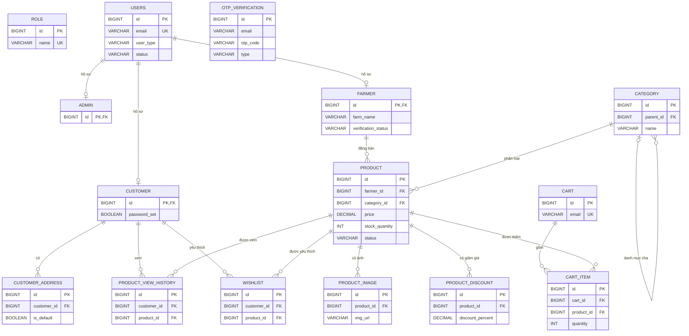
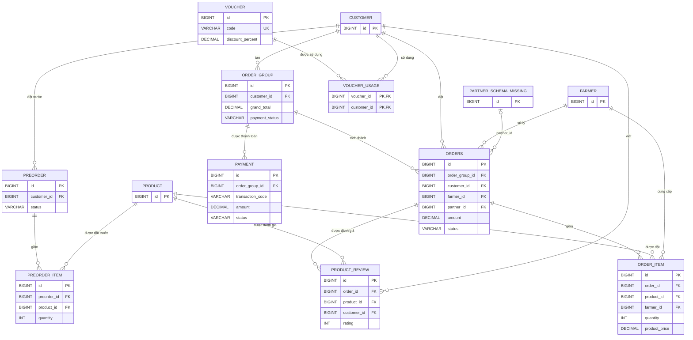

# ERD - AgriMarket

Sơ đồ được tách thành ba phần để dễ đọc khi trình bày. Các bảng và quan hệ được đối chiếu với [schema PostgreSQL](./Agrimarket-system-postgres.sql). `PK` là khóa chính, `FK` là khóa ngoại.

## 1. Tài khoản, danh mục và sản phẩm

## 2. Giỏ hàng, đơn hàng và thanh toán

> **Lưu ý:** `PARTNER_SCHEMA_MISSING` chỉ biểu diễn bảng `partner` được tham chiếu bởi `orders.partner_id`. Schema hiện tại có khóa ngoại này nhưng chưa định nghĩa `CREATE TABLE partner`.

## 3. Tương tác, hỗ trợ và AI

```mermaid
erDiagram
    USERS {
        BIGINT id PK
    }
    CUSTOMER {
        BIGINT id PK
    }
    FARMER {
        BIGINT id PK
    }
    PRODUCT {
        BIGINT id PK
    }
    CONVERSATION {
        BIGINT id PK
        BIGINT customer_id FK
        BIGINT farmer_id FK
    }
    MESSAGE {
        BIGINT id PK
        BIGINT conversation_id FK
        BIGINT sender_id FK
    }
    LIVESTREAM {
        BIGINT id PK
        BIGINT farmer_id FK
    }
    LIVESTREAM_PRODUCT {
        BIGINT livestream_id PK, FK
        BIGINT product_id PK, FK
    }
    LIVESTREAM_COMMENT {
        BIGINT id PK
        BIGINT livestream_id FK
        BIGINT sender_id FK
    }
    SUPPORT_REQUEST {
        BIGINT id PK
        BIGINT sender_id FK
    }
    SUPPORT_MESSAGE {
        BIGINT id PK
        BIGINT support_request_id FK
        BIGINT sender_id FK
    }
    ADMIN_NOTIFICATION {
        BIGINT id PK
        VARCHAR title
        VARCHAR status
    }
    NOTIFICATION {
        BIGINT id PK
        BIGINT receiver_id FK
        VARCHAR receiver_type
        BOOLEAN is_read
    }
    REPORT {
        BIGINT id PK
        BIGINT reporter_id FK
        VARCHAR target_type
        BIGINT target_id
    }
    FARMER_FOLLOW {
        BIGINT customer_id PK, FK
        BIGINT farmer_id PK, FK
    }
    AI_CONVERSATION {
        BIGINT id PK
        BIGINT customer_id FK
    }
    AI_MESSAGE {
        BIGINT id PK
        BIGINT conversation_id FK
    }
    AI_PRODUCT_DESCRIPTION_HISTORY {
        BIGINT id PK
        BIGINT farmer_id FK
        BIGINT product_id FK
    }
    AI_PRICE_SUGGESTION {
        BIGINT id PK
        BIGINT farmer_id FK
        BIGINT product_id FK
    }
    AI_RECOMMENDATION {
        BIGINT id PK
        BIGINT customer_id FK
        BIGINT product_id FK
    }
    AI_SEARCH_HISTORY {
        BIGINT id PK
        BIGINT customer_id FK
    }
    AI_CONTENT_MODERATION {
        BIGINT id PK
        BIGINT product_id FK
        BOOLEAN is_safe
    }

    CUSTOMER ||--o{ CONVERSATION : "tham gia"
    FARMER ||--o{ CONVERSATION : "tham gia"
    CONVERSATION ||--o{ MESSAGE : "có tin nhắn"
    USERS ||--o{ MESSAGE : "gửi"
    FARMER ||--o{ LIVESTREAM : "phát"
    LIVESTREAM ||--o{ LIVESTREAM_PRODUCT : "ghim"
    PRODUCT ||--o{ LIVESTREAM_PRODUCT : "được ghim"
    LIVESTREAM ||--o{ LIVESTREAM_COMMENT : "có bình luận"
    USERS ||--o{ LIVESTREAM_COMMENT : "viết"
    USERS ||--o{ SUPPORT_REQUEST : "gửi"
    SUPPORT_REQUEST ||--o{ SUPPORT_MESSAGE : "có trao đổi"
    USERS ||--o{ SUPPORT_MESSAGE : "gửi"
    USERS ||--o{ NOTIFICATION : "nhận"
    USERS ||--o{ REPORT : "báo cáo"
    CUSTOMER ||--o{ FARMER_FOLLOW : "theo dõi"
    FARMER ||--o{ FARMER_FOLLOW : "được theo dõi"
    CUSTOMER ||--o{ AI_CONVERSATION : "trò chuyện"
    AI_CONVERSATION ||--o{ AI_MESSAGE : "có tin nhắn"
    FARMER ||--o{ AI_PRODUCT_DESCRIPTION_HISTORY : "tạo mô tả"
    PRODUCT o|--o{ AI_PRODUCT_DESCRIPTION_HISTORY : "liên quan"
    FARMER ||--o{ AI_PRICE_SUGGESTION : "nhận gợi ý giá"
    PRODUCT o|--o{ AI_PRICE_SUGGESTION : "liên quan"
    CUSTOMER ||--o{ AI_RECOMMENDATION : "nhận gợi ý"
    PRODUCT ||--o{ AI_RECOMMENDATION : "được gợi ý"
    CUSTOMER ||--o{ AI_SEARCH_HISTORY : "tìm kiếm"
    PRODUCT ||--o{ AI_CONTENT_MODERATION : "được kiểm duyệt"
```

## Ghi chú khi trình bày

- `order_group` là đơn tổng; `orders` là các đơn con tách theo nhà vườn; `order_item` chứa các sản phẩm trong từng đơn con.
- `role`, `otp_verification`, `cart` và `admin_notification` hiện không có khóa ngoại nối tới các bảng khác trong schema.
- `notification.receiver_id` trỏ tới `users`; `receiver_type` xác định loại người nhận. `report.target_id` là liên kết đa hình theo `target_type`, không được khai báo thành khóa ngoại.
- Mở file bằng Markdown Preview trong VS Code hoặc GitHub để xem các khối Mermaid được render thành sơ đồ.
